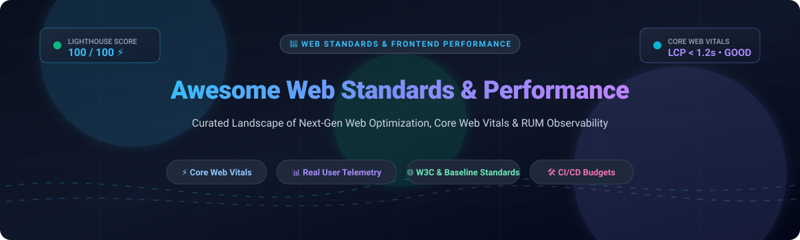

# ⚡ Awesome Web Standards & Frontend Performance 🚀

**A comprehensive, SEO-optimized, curated directory of enterprise SaaS solutions, monitoring suites, and top-tier open-source tools for Web Standards, Core Web Vitals (LCP, INP, CLS), Synthetic Benchmarking, and Frontend Real User Monitoring (RUM).**

*Last updated: November 2026* 🌟 Star this repository if it helps streamline your web performance workflow! 🌟

---

## 📑 Table of Contents

- [🌐 Overview & Strategic Architecture](#-overview--strategic-architecture)
- [📈 Sector Overview & Market Dynamics](#-sector-overview--market-dynamics)
- [💼 SaaS & Commercial Cloud Platforms](#-saas--commercial-cloud-platforms)
- [💻 Open-Source GitHub Projects](#-open-source-github-projects)
- [🎯 Frontend Performance Best Practices Checklist](#-frontend-performance-best-practices-checklist)
- [🤝 How to Contribute](#-how-to-contribute)
- [💖 Support & Sponsorship](#-support--sponsorship)
- [⭐ Star History](#-star-history)
- [⚖️ Disclaimer & License](#-disclaimer--license)

---

## 🌐 Overview & Strategic Architecture

Modern frontend web engineering demands adherence to evolving W3C/WHATWG web standards and strict compliance with Google's **Core Web Vitals** metrics:
- **Largest Contentful Paint (LCP)**: Perceived page load speed (target: $\le 2.5\text{s}$).
- **Interaction to Next Paint (INP)**: Main-thread responsiveness and input latency (target: $\le 200\text{ms}$).
- **Cumulative Layout Shift (CLS)**: Visual layout stability during render (target: $\le 0.1$).

This repository indexes the ecosystem into two complementary operational pillars:
1. **SaaS & Enterprise Observability Suites**: Cloud-hosted synthetic test environments, automated PR performance budgets, and distributed real user telemetry across diverse geographical locations and edge CDNs.
2. **Open-Source Frameworks & Libraries**: Lightweight client instrumentation packages, headless browser test runners, AST bundle analyzers, and critical CSS inliners designed for direct CI/CD pipeline integration.

---

## 📈 Sector Overview & Market Dynamics

The global Web Performance & Digital Experience Monitoring (DEM / APM / RUM) market is valued at approximately **$6.2 Billion in 2025/2026**, expanding at a Compound Annual Growth Rate (CAGR) of **11.4%** as search ranking algorithms (Google Search Console Core Web Vitals updates) and e-commerce conversions increasingly hinge upon sub-second page delivery.

The market exhibits **moderate fragmentation with high concentration at the high-end enterprise tier**:
- **Enterprise Concentrated Core**: Full-stack observability giants (Datadog, Dynatrace, New Relic) and cloud edge infrastructures (Vercel, Cloudflare, Akamai) dominate cross-stack telemetry contracts through unified APM + RUM suites.
- **Specialized Best-of-Breed Landscape**: A vibrant tier of dedicated, specialist performance platforms (DebugBear, SpeedCurve, Calibre, WebPageTest) competes vigorously by providing deeper Chrome DevTools waterfall introspection, automated INP interaction diagnostic flamegraphs, and targeted Lighthouse budget enforcement that generic monitoring platforms frequently overlook.

---

## 💼 SaaS & Commercial Cloud Platforms

The table below lists leading commercial SaaS and hosted platforms, sorted by corporate valuation / estimated revenue (descending). Pricing and free tier specifics reflect current entry points.

| Company / Product | Est. Valuation / Revenue | Starting Price | Free Tier / Free Trial Limits | Key Capabilities |
| :--- | :--- | :--- | :--- | :--- |
| **[Google PageSpeed Insights & CrUX](https://web.dev)** | **$2.2T+ Valuation** *(Alphabet Inc.)* | **$0.00 / month** *(Completely Free)* | **Free Forever**: 25,000 API requests/day with Google Cloud API key; unlimited public web UI runs | Chrome User Experience Report (CrUX) field data combined with automated lab Lighthouse diagnostics. |
| **[Datadog Real User Monitoring (RUM)](https://datadoghq.com)** | **$45B+ Valuation** *(Public: NASDAQ: DDOG)* | **$1.50 per 1,000 sessions/month** | **14-day free trial**: Full access to RUM, synthetic test runners, and APM dashboard without credit card | Enterprise-scale distributed frontend session replay, Core Web Vitals telemetry, and end-to-end API latency correlation. |
| **[Sentry Performance & Web Vitals](https://sentry.io)** | **$3B+ Valuation** *(Series E)* | **$26.00 / month** *(Team Tier billed annually)* | **Free Forever (Developer Tier)**: 10,000 performance units, 5,000 error events, and 1 user seat per month | Frontend error correlation with slow spans, INP/LCP user impact breakdowns, and transaction waterfalls. |
| **[Vercel Speed Insights](https://vercel.com)** | **$3.25B Valuation** *(Series E)* | **$20.00 / user / month** *(Pro Plan)* | **Free Forever (Hobby Tier)**: Up to 10,000 Web Vitals data points per month across deployed personal projects | Zero-configuration Real User Monitoring instrumenting real visitor routes, devices, and connection speed distributions. |
| **[Pingdom Website Speed Test](https://pingdom.com)** | **$2.5B+ Valuation** *(SolarWinds: NYSE: SWI)* | **$10.00 / month** *(Synthetic Monitoring)* | **30-day free trial**: Up to 10 synthetic uptime checks, 1 page speed check, and full alerting suite | Synthetic page speed benchmarking across global probe stations, analyzing load times and asset breakdowns. |
| **[Uptrends Website Speed Test](https://uptrends.com)** | **$150M+ Est. Valuation** *(Idera Corp.)* | **$18.00 / month** *(Starter tier)* | **30-day free trial**: Full access to synthetic Core Web Vitals checks, multi-browser tests, and 220+ global checkpoints | Continuous synthetic Lighthouse audits, multi-region browser simulations, and waterfall timing metrics. |
| **[WebPageTest by Catchpoint](https://webpagetest.org)** | **$50M+ Est. Valuation** *(Catchpoint Ecosystem)* | **$17.50 / month** *(billed annually for Starter)* | **Free Forever**: 300 test runs per month using public cloud nodes; or 30-day trial for enterprise features | Gold-standard synthetic engine offering scriptable multi-step user actions, CPU/network throttling, and filmstrips. |
| **[SpeedCurve](https://speedcurve.com)** | **$15M - $30M Est. Valuation** *(Bootstrapped)* | **$114.00 / month** *(billed annually for 1.2M checks/yr)* | **30-day free trial**: 30 days full feature access with 10,000 synthetic test runs and RUM telemetry credits | Deep synthetic Lighthouse benchmarking, JavaScript CPU flamecharts, and side-by-side video rendering comparisons. |
| **[DebugBear](https://debugbear.com)** | **$10M - $25M Est. Valuation** *(Independent)* | **$99.00 / month** *(Basic synthetic & CrUX monitoring)* | **14-day free trial**: Full access to automated synthetic monitoring, PR Lighthouse checks, and CrUX dashboards | Automated page speed monitoring, PR performance budgets, LCP sub-part breakdowns, and INP interaction traces. |
| **[Calibre](https://calibreapp.com)** | **$8M - $15M Est. Valuation** *(Independent)* | **$70.00 / month** *(Company tier billed annually)* | **14-day free trial**: Unlimited tests, full CLI/API access, and pull request review integrations | CI/CD performance gates, multi-device synthetic test profiles, and third-party script bloat regression tracking. |
| **[Treo](https://treo.sh)** | **$3M - $8M Est. Valuation** *(Independent)* | **$75.00 / month** *(Team tier for 10 projects)* | **14-day free trial**: Full access to Lighthouse CI automation, historical CrUX tracking, and budget assertions | Cloud Lighthouse CI runner tracking Chrome UX Report distributions and performance regressions across releases. |

---

## 💻 Open-Source GitHub Projects

The following curated open-source repositories are strictly sorted by their current GitHub star count (descending). Each repository includes an official social star badge directly linking to its stargazers page.

| Repository & Stars | Category / Purpose | Key Highlights & Architecture |
| :--- | :--- | :--- |
| **[Playwright](https://github.com/microsoft/playwright)**  | Synthetic Testing & Automation | Cross-browser automation engine (Chromium, Firefox, WebKit) for multi-step synthetic journeys, DevTools traces, and CPU-throttled interaction latency benchmarking. |
| **[Sharp](https://github.com/lovell/sharp)**  | Asset & Image Optimization | High-speed Node.js image processing library powered by `libvips` for real-time asset conversion into modern AVIF and WebP formats to minimize LCP. |
| **[Google Lighthouse](https://github.com/GoogleChrome/lighthouse)**  | Web Auditing & Diagnostics | Industry standard automated auditing engine measuring performance, accessibility (a11y), progressive web apps, SEO, and web standards compliance. |
| **[Modern Web Guidance](https://github.com/GoogleChrome/modern-web-guidance)**  | Standards & Architecture | Official Google Chrome diagnostic framework and repository helping teams adopt modern web standards, Baseline APIs, and performance architectural rules. |
| **[lazysizes](https://github.com/aFarkas/lazysizes)**  | Asset & Media Loading | High-performance, SEO-friendly responsive lazy loader for images, iframes, and scripts without requiring external dependencies. |
| **[Partytown](https://github.com/BuilderIO/partytown)**  | Script Execution Offloading | Relocates CPU-intensive third-party analytics and tracking scripts into background Web Workers, freeing up the main thread to boost INP. |
| **[Webpack Bundle Analyzer](https://github.com/webpack-contrib/webpack-bundle-analyzer)**  | Bundle Analysis & Tree-Shaking | Interactive zoomable treemap visualizer illustrating JavaScript payload compositions to isolate dependency bloat and eliminate unused exports. |
| **[Quicklink](https://github.com/GoogleChromeLabs/quicklink)**  | Speculative Navigation | Accelerates subsequent page navigations by prefetching and prerendering in-viewport links during browser idle periods using `requestIdleCallback`. |
| **[Critical](https://github.com/addyosmani/critical)**  | CSS Optimization | Extracts and inlines above-the-fold critical path CSS while deferring non-critical styles to eliminate render-blocking CSS delays. |
| **[web-vitals](https://github.com/GoogleChrome/web-vitals)**  | Core Web Vitals RUM Library | Ultra-lightweight (~2 KB) client library accurately measuring all Core Web Vitals (LCP, INP, CLS, FCP, TTFB) from genuine visitor browsers. |
| **[Axe-core](https://github.com/dequelabs/axe-core)**  | Standards & Accessibility | Automated accessibility testing engine powering Google Lighthouse, ensuring modern WCAG and W3C digital inclusion standards compliance. |
| **[Lighthouse CI](https://github.com/GoogleChrome/lighthouse-ci)**  | CI/CD Performance Budgets | Automated CLI and server harness running Lighthouse assertions on every PR commit to prevent performance regressions before deployment. |
| **[Size Limit](https://github.com/ai/size-limit)**  | Bundle Budgeting | Performance budget CLI calculating actual execution and download times on simulated low-end mobile devices to stop JavaScript creep in pull requests. |
| **[loadCSS](https://github.com/filamentgroup/loadCSS)**  | Non-Blocking Resource Loading | Foundational pattern and utility for loading stylesheets asynchronously to prioritize initial paint and avoid render-blocking waterfalls. |
| **[MDN Browser Compat Data](https://github.com/mdn/browser-compat-data)**  | Web Standards Matrix | Comprehensive machine-readable repository tracking cross-browser support for ECMAScript, CSS, HTML, and Web API capabilities. |
| **[Sitespeed.io](https://github.com/sitespeedio/sitespeed.io)**  | Synthetic Monitoring Stack | Self-hosted end-to-end performance suite orchestrating Browsertime, Lighthouse, and WebPageTest with custom Grafana metric visualization. |
| **[Unlighthouse](https://github.com/harlan-zw/unlighthouse)**  | Batch Site Auditing | High-throughput site crawler executing Lighthouse audits across hundreds of subpages simultaneously with an intuitive web dashboard. |
| **[Webhint](https://github.com/webhintio/hint)**  | Linting & Best Practices | OpenJS Foundation customizable linter evaluating web projects for accessibility, speed, cross-browser compatibility, and modern PWA standards. |
| **[WebPageTest Core](https://github.com/Catchpoint/WebPageTest)**  | Synthetic Engine Codebase | Full open-source server and test agent implementation for self-hosting private synthetic performance testing labs. |
| **[Yellow Lab Tools](https://github.com/YellowLabTools/YellowLabTools)**  | Code Quality & DOM Profiling | In-depth frontend quality analyzer profiling DOM node counts, complex CSS selectors, web font overhead, and JavaScript memory footprints. |
| **[Phantomas](https://github.com/macbre/phantomas)**  | CLI Metrics Collector | Headless browser execution harness gathering hundreds of granular metrics including asset counts, cookie sizes, DOM queries, and layout events. |
| **[Preload Webpack Plugin](https://github.com/GoogleChromeLabs/preload-webpack-plugin)**  | Resource Hint Automation | Webpack build plugin automatically wiring `<link rel="preload">` and `<link rel="prefetch">` tags for critical chunks into emitted HTML documents. |
| **[Capo.js](https://github.com/rviscomi/capo.js)**  | Head Tag Optimization | Evaluates and reorganizes elements in the HTML `<head>` using an optimal priority hierarchy to eliminate render delays and accelerate LCP. |
| **[web-features (Baseline)](https://github.com/web-platform-dx/web-features)**  | Standards Baseline Registry | W3C WebDX Community Group dataset tracking web platform features that have reached widely supported Baseline availability across engines. |
| **[Beasties](https://github.com/danielroe/beasties)**  | Critical CSS Inliner | Modern, fast successor to Critters for Vite and Webpack, extracting and inlining above-the-fold styles while lazy-loading remaining CSS. |
| **[Browsertime](https://github.com/sitespeedio/browsertime)**  | Browser Automation & Video Metrics | Harness driving real desktop and mobile browsers to measure Navigation Timing, visual Speed Index, and video-based layout progression. |
| **[Garie](https://github.com/boyney123/garie)**  | Automated Docker Dashboard | Turnkey dockerized monitoring system running scheduled Lighthouse, Browsertime, and custom web tests with InfluxDB storage and Grafana graphs. |
| **[PerfCascade](https://github.com/micmro/PerfCascade)**  | Waterfall Visualization | Embeddable client-side SVG HAR (HTTP Archive) viewer rendering detailed network request timings, connection phases, and payload sizes. |

---

## 🎯 Frontend Performance Best Practices Checklist

⚡ Optimize your web delivery pipeline with these industry-standard recommendations:

- **Optimize LCP (Largest Contentful Paint)**:
  - 🖼️ Preload high-priority hero images using `<link rel="preload" as="image" fetchpriority="high">`.
  - 📦 Convert raster images to next-gen WebP/AVIF formats and specify explicit `width` and `height` attributes.
  - 🚀 Serve assets over HTTP/3 or HTTP/2 backed by an edge Content Delivery Network (CDN).
- **Optimize INP (Interaction to Next Paint)**:
  - 🧵 Yield execution to the main thread during heavy calculations with `scheduler.yield()` or `setTimeout`.
  - 📦 Relocate tracking pixels and heavy analytics into Web Workers via libraries like Partytown.
  - 🧹 Debounce event listeners and minimize forced synchronous layout recalculations.
- **Optimize CLS (Cumulative Layout Shift)**:
  - 📐 Reserve layout space for ads, banners, embeds, and dynamic widgets with CSS `aspect-ratio` or `min-height`.
  - 🔤 Load web fonts using `font-display: swap` alongside matching metric fallbacks (`size-adjust`).
  - 🔄 Avoid injecting dynamic DOM elements above existing rendered content.

---

## 🤝 How to Contribute

Contributions are welcome from frontend engineers, performance advocates, and open-source creators! 🛠️

1. 🍴 Fork this repository.
2. 🌿 Create a descriptive branch: `git checkout -b feat/add-performance-tool`.
3. 📝 Add your tool in either the SaaS or Open-Source section maintaining strict star count / valuation order.
4. 🔎 Verify pricing, free tier details, or repository star badges.
5. 📬 Submit a Pull Request with a clear rationale and verification links.

---

## 💖 Support & Sponsorship

Thank you so much for exploring and using this repository! If this curated guide helps streamline your web performance audits, CI/CD budgets, or Core Web Vitals optimization, please consider supporting the project:

- ⭐ **Star** this repository to help others discover it.
- 🍴 **Fork** and contribute new tools or updates.
- 📢 **Share** it with your engineering team and across social media.
- ☕ **Buy me a coffee**: Support ongoing maintenance and open-source research via the [GitHub Sponsors Dashboard](https://github.com/sponsors/ishandutta2007).

---

## ⭐ Star History

---

## ⚖️ Disclaimer & License

- **License**: Released under the [MIT License](LICENSE).
- **Trademarks**: Product names, logos, and brands mentioned are property of their respective owners. Inclusion does not imply official endorsement.
